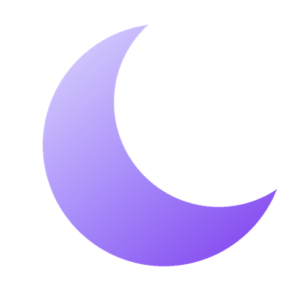
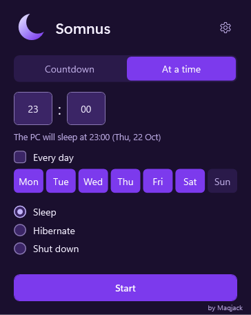
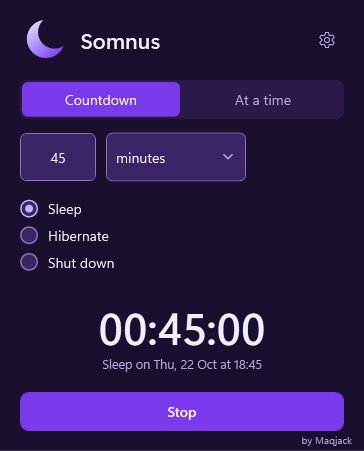
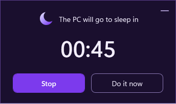

# Somnus



Somnus puts a Windows PC to sleep, hibernates it or shuts it down after a countdown or at a chosen
time, with a 60-second warning in which you can stop it.

[Polski](README.pl.md) · Made by Mac ([@Maqjack](https://github.com/Maqjack))

<p>
  
  
  
</p>

## Download

Get the latest version from [Releases](../../releases): the installer
(`Somnus-Setup-<version>-en.exe`) or the portable zip (`Somnus-<version>-win-x64-portable-en.zip`).
Every download also comes in Polish (`-pl`). The files are not code-signed, so before you run one,
compare its SHA256 checksum with `SHA256SUMS.txt` from the same release.

## How to use it

1. Choose **Countdown** (a delay) or **At a time** (a clock time). In **At a time**, tick **Every
   day** or chosen days to repeat it.
2. Type the number and pick seconds, minutes or hours, or type the hour and the minute.
3. Choose **Sleep**, **Hibernate** or **Shut down**. For a shutdown you can tick **Force close
   apps**; unsaved work in other apps is then lost.
4. Press **Start**. The window hides in the tray; hover over the moon to see the time left, and
   click it to change or stop the countdown.

During the last 60 seconds a warning in the bottom-right corner of the screen offers **Stop** (also
Esc) and **Do it now**. Its minus button only puts it on the taskbar while the countdown goes on. If
the PC wakes up less than a minute before the scheduled time or after it, Somnus cancels instead of
acting.

The gear opens the settings: the language (English or Polish), the warning, remembering the last
countdown, the sound of the last 20 seconds (a lullaby, no sound, or the start of your own MP3, WAV,
WMA, M4A, AAC or FLAC file) and **Start with Windows**.

## Requirements

Windows 10 22H2 or Windows 11, x64, and the Microsoft .NET Desktop Runtime 10. The installer adds
the runtime when it is missing: about 60 MB from Microsoft, and Windows asks for permission once.
For the portable zip, install it from [Microsoft](https://dotnet.microsoft.com/download/dotnet/10.0).
Somnus itself needs no administrator rights.

## Privacy

Somnus never uses the network and sends no telemetry; only its installer goes online, to get the
.NET runtime from Microsoft. It keeps its settings and daily logs (7 days) in `%APPDATA%\Somnus`,
and the logs write your profile folder as `%USERPROFILE%`. It starts with Windows only if you turn
that on.

## If something does not work

- **"Windows protected your PC"**: Somnus is not code-signed. Compare the checksum, then choose
  **More info** and **Run anyway**.
- **Hibernate is greyed out**: hibernation is off in Windows. Run `powercfg /hibernate on` in a
  terminal opened as administrator.
- **Sleep is greyed out**: the PC uses Modern Standby, which apps cannot start. Use Hibernate or
  Shut down.
- **A normal shutdown did not happen**: an app with unsaved work stopped it. Save your work first,
  or tick **Force close apps**.
- **Anything else**: the details are in `%APPDATA%\Somnus\logs`. Please
  [report it](../../issues).

## Uninstalling

Settings > Apps > Installed apps > Somnus > Uninstall; this also removes the settings, the logs and
Start with Windows. For the portable build, turn off Start with Windows in the settings, then delete
its folder and `%APPDATA%\Somnus`. The .NET Desktop Runtime stays, because other apps may use it.

## Building from source

With the [.NET 10 SDK](https://dotnet.microsoft.com/download/dotnet/10.0):

```
run.bat --dry-run               rem runs Somnus and only simulates the power actions
dotnet test Somnus.sln          rem runs the tests
py -3 scripts/build.py          rem builds the installers and zips (needs Inno Setup 6)
```

Without `--dry-run`, `run.bat` performs real power actions.

## How it was made

Somnus is also a small portfolio project. [How Somnus was made](docs/HOW-IT-WAS-MADE.md) shows the
architecture, the decisions and how its quality was kept.

## License

[MIT License](LICENSE), copyright (c) 2026 Mac (Maqjack).
