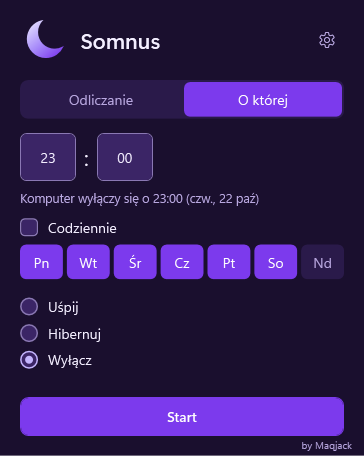
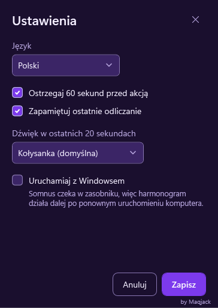
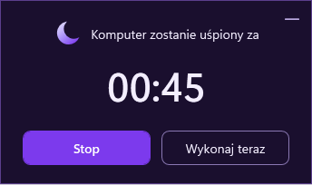

# Somnus


Somnus usypia, hibernuje lub wyłącza komputer z Windowsem po odliczeniu czasu albo o wskazanej
godzinie, z 60-sekundowym ostrzeżeniem, w którym można zatrzymać odliczanie.

[English](README.md) · Autor: Mac ([@Maqjack](https://github.com/Maqjack))

<p>
  
  
  
</p>

## Pobieranie

Najnowszą wersję pobierzesz z [wydań](../../releases): instalator
(`Somnus-Setup-<wersja>-pl.exe`) albo wersję przenośną (`Somnus-<wersja>-win-x64-portable-pl.zip`).
Każdy plik jest też po angielsku (`-en`). Pliki nie są podpisane certyfikatem, więc przed
uruchomieniem porównaj ich sumę SHA256 z plikiem `SHA256SUMS.txt` z tego samego wydania.

## Jak używać

1. Wybierz **Odliczanie** (po czasie) albo **O której** (o godzinie). W trybie **O której** zaznacz
   **Codziennie** albo wybrane dni, żeby odliczanie się powtarzało.
2. Wpisz liczbę i wybierz sekundy, minuty lub godziny albo wpisz godzinę i minutę.
3. Wybierz **Uśpij**, **Hibernuj** lub **Wyłącz**. Przy wyłączeniu możesz zaznaczyć **Wymuś
   zamknięcie programów**; niezapisana praca w innych programach przepadnie.
4. Naciśnij **Start**. Okno chowa się do zasobnika; po najechaniu na półksiężyc widać pozostały
   czas, a kliknięcie pozwala zmienić lub zatrzymać odliczanie.

W ostatnich 60 sekundach ostrzeżenie w prawym dolnym rogu ekranu daje do wyboru **Stop** (także Esc)
i **Wykonaj teraz**. Jego minus tylko przenosi je na pasek zadań, a odliczanie trwa dalej. Jeśli
komputer wybudzi się na mniej niż minutę przed zaplanowanym momentem albo po nim, Somnus anuluje
odliczanie zamiast działać.

Koło zębate otwiera ustawienia: język (polski lub angielski), ostrzeżenie, zapamiętywanie ostatniego
odliczania, dźwięk ostatnich 20 sekund (kołysanka, bez dźwięku albo początek własnego pliku MP3, WAV,
WMA, M4A, AAC lub FLAC) i **Uruchamiaj z Windowsem**.

## Wymagania

Windows 10 22H2 lub Windows 11, x64, oraz środowisko Microsoft .NET Desktop Runtime 10. Instalator
dodaje je, jeśli go brakuje: ok. 60 MB od Microsoftu, a Windows raz prosi o zgodę. Do wersji
przenośnej zainstaluj je ze strony [Microsoftu](https://dotnet.microsoft.com/download/dotnet/10.0).
Sam Somnus nie potrzebuje uprawnień administratora.

## Prywatność

Somnus nigdy nie korzysta z sieci i nie wysyła telemetrii; tylko instalator łączy się z siecią, żeby
pobrać od Microsoftu środowisko .NET. Ustawienia i dzienne logi (7 dni) trzyma w `%APPDATA%\Somnus`,
a w logach folder profilu jest zapisany jako `%USERPROFILE%`. Z Windowsem uruchamia się tylko
wtedy, gdy włączysz to w ustawieniach.

## Gdy coś nie działa

- **„System Windows ochronił ten komputer”**: Somnus nie jest podpisany certyfikatem. Porównaj sumę
  kontrolną, potem wybierz **Więcej informacji** i **Uruchom mimo to**.
- **Hibernacja jest wyszarzona**: hibernacja jest wyłączona w Windowsie. Uruchom
  `powercfg /hibernate on` w terminalu otwartym jako administrator.
- **Uśpienie jest wyszarzone**: komputer używa trybu Modern Standby, którego aplikacje nie mogą
  włączyć. Użyj hibernacji lub wyłączenia.
- **Zwykłe wyłączenie nie nastąpiło**: program z niezapisaną pracą je zatrzymał. Najpierw zapisz
  pracę albo zaznacz **Wymuś zamknięcie programów**.
- **Coś innego**: szczegóły są w `%APPDATA%\Somnus\logs`. [Zgłoś problem](../../issues).

## Odinstalowanie

Ustawienia > Aplikacje > Zainstalowane aplikacje > Somnus > Odinstaluj; usuwa to także ustawienia,
logi i uruchamianie z Windowsem. Przed usunięciem wersji przenośnej wyłącz w ustawieniach
**Uruchamiaj z Windowsem**, potem skasuj jej folder i `%APPDATA%\Somnus`. Środowisko .NET Desktop
Runtime zostaje, bo mogą go używać inne programy.

## Budowanie ze źródeł

Z [.NET 10 SDK](https://dotnet.microsoft.com/download/dotnet/10.0):

```
run.bat --dry-run               rem uruchamia Somnusa i tylko symuluje akcje zasilania
dotnet test Somnus.sln          rem uruchamia testy
py -3 scripts/build.py          rem buduje instalatory i paczki zip (potrzebny Inno Setup 6)
```

Bez `--dry-run` skrypt `run.bat` wykonuje prawdziwe akcje zasilania.

## Jak powstał

Somnus to także mały projekt do portfolio. [Jak powstał Somnus](docs/HOW-IT-WAS-MADE.pl.md) pokazuje
architekturę, decyzje i to, jak dbaliśmy o jakość.

## Licencja

[Licencja MIT](LICENSE), copyright (c) 2026 Mac (Maqjack).
