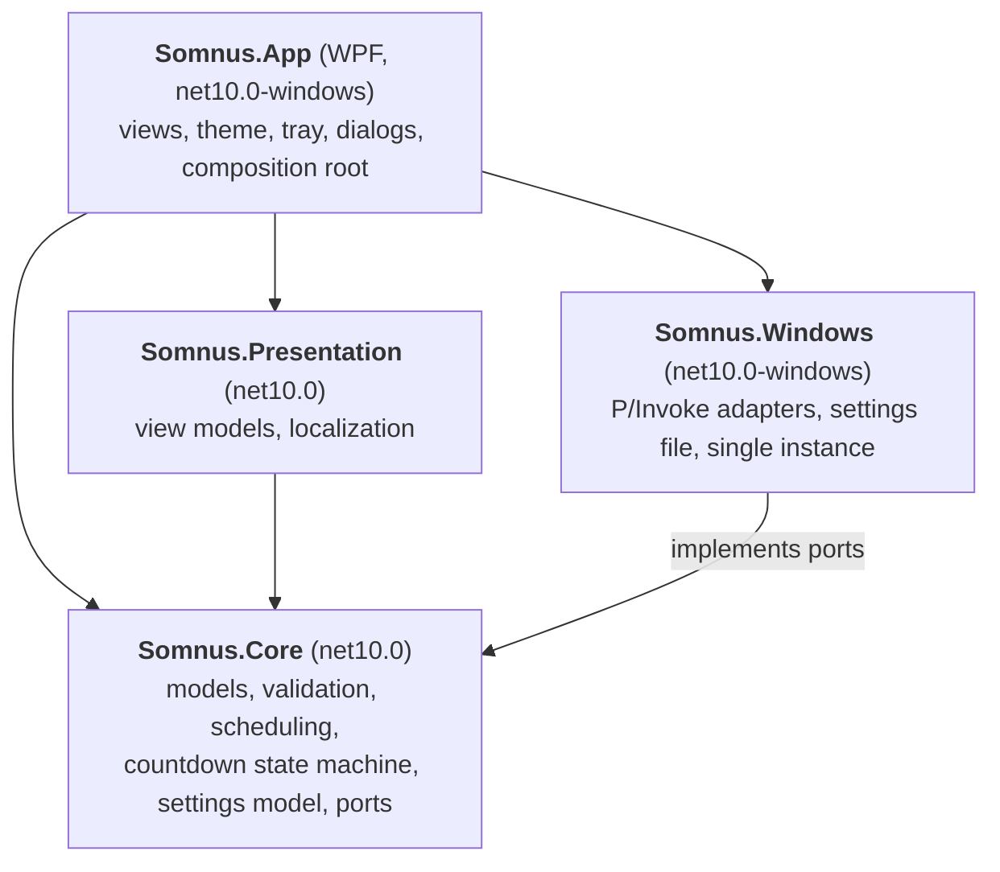
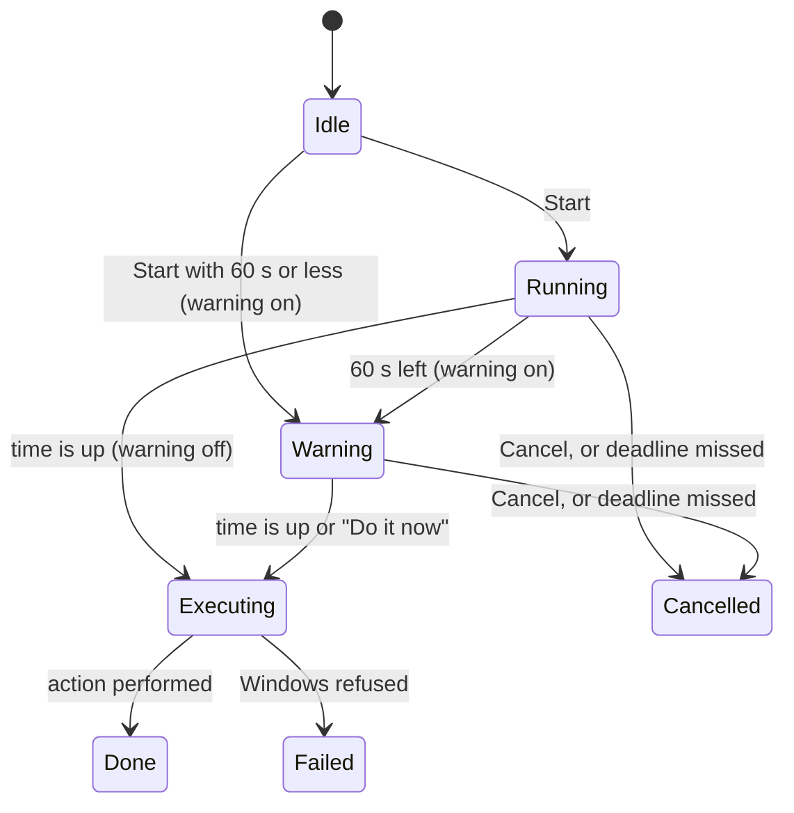
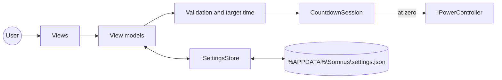

# Architecture

[Polski](ARCHITECTURE.pl.md)

Somnus is a small WPF app split into four projects so that all logic can be tested
without Windows, without a UI and without ever touching the real power state of the PC.

## Modules

Dependency rule: `Core` depends on no other Somnus project; `Presentation` and `Windows`
depend only on `Core`; `App` wires everything together. `Core` and `Presentation` never
reference WPF, WinForms or P/Invoke. Tests enforce this (`DependencyRuleTests`).

## Ports and adapters

| Port (in Core) | Purpose | Adapter (in Windows) | Test double |
|---|---|---|---|
| `IPowerController` | Sleep, hibernate, shut down (optionally forced) | `WindowsPowerController`: `SetSuspendState`, `ExitWindowsEx` (ADR 0006) | `DryRunPowerController`, fakes |
| `IPowerCapabilities` | Which actions this PC supports | `WindowsPowerCapabilities`: `GetPwrCapabilities` | fakes |
| `IKeepAwake` | Keep the PC from idle sleep during a countdown | `WindowsKeepAwake`: power request (ADR 0007) | fakes |
| `ISettingsStore` | Load and save settings | `JsonFileSettingsStore`: `%APPDATA%\Somnus\settings.json` | temp directory |
| `IAutostart` | Start with Windows, when the user turns it on (#83) | `RunKeyAutostart`: the user's Run key | `SimulatedAutostart` in a dry run, a test key |
| `System.TimeProvider` | Current time and timers | `TimeProvider.System` | `FakeTimeProvider` |

Real power actions are reachable only through `IPowerController`. `DryRunPolicy` decides at
startup: Debug builds and runs with `--dry-run` get `DryRunPowerController`, which logs and
raises an event for a notification instead of acting (rule R-01). Only the composition root
may create `WindowsPowerController`, and a CI check enforces it.

Capabilities: sleep needs S3 (Modern Standby PCs have no S3 an app can enter), hibernation
needs S4 and the hibernation file that `powercfg /hibernate off` removes.

Settings are written to a temporary file that then replaces `settings.json`, so a crash leaves
either the old or the new file. An unreadable file is kept as `settings.json.bak` before defaults
are used; single invalid values fall back to their defaults without discarding the rest.

## Countdown

`CountdownSession` (Core) owns the countdown:

- The target is an absolute instant. Remaining time is `target - now`, recomputed on every
  250 ms tick, so the countdown never drifts (criterion C2: ±2 s even after 24 h).
- *In* mode: target = now + duration. *At* mode: the next local occurrence of HH:mm
  (today if still ahead, otherwise tomorrow), computed with the time zone rules: a time
  skipped when clocks jump forward moves forward by the gap (02:30 becomes 03:30), and a
  time that happens twice when clocks go back uses the first occurrence still ahead.
- If the countdown is 60 s or shorter and the warning is on, it starts directly in `Warning`.
- **Missed deadline:** a gap of more than 5 s between two ticks means the PC was asleep or the
  clock jumped. If the countdown comes back less than 60 s before the target or after it, Somnus
  cancels instead of acting, with the warning on or off, so waking the PC never triggers a
  surprise action (assumption A8).
- The power action runs on a background thread (sleep and hibernate return only after the PC
  wakes up); a refused or failed action ends in `Failed` and is logged.
- Keep-awake is held while the countdown is active and always released afterwards (R-06).
- The session is thread-safe; `Changed` fires on state changes and once per whole second,
  and listeners read an immutable `CountdownSnapshot`.

## User interface

- **View models** (`Somnus.Presentation`, CommunityToolkit.Mvvm): `MainViewModel` turns input into a
  `CountdownRequest`, validates it inline, starts, cancels and restarts the countdown and remembers
  the last values; `ShellViewModel` drives the tray icon, the warning window, notifications and exit;
  `WarningViewModel` serves the warning window and `SettingsViewModel` the settings panel, which
  `MainViewModel` opens inside the main window (its language previews live). They depend only on ports
  (`IUiDispatcher`, `IDialogService`, `INotificationService`), so all of them are unit tested.
- **Threading:** the countdown raises `Changed` on timer threads; view models hop to the UI thread
  through `IUiDispatcher` and read the immutable snapshot there.
- **Views** (`Somnus.App/Views`): XAML only, every colour and font from `Theme/*.xaml` (R-02), every
  text from `Strings.resx` through the `{l:Tr Key}` markup extension (R-04). `ShellController` hides
  the main window to the tray when a countdown starts, opens the warning window for the last minute and
  exits on request; closing the main window during a countdown hides it instead (assumption A5).
- **Tray:** a WinForms `NotifyIcon` (ADR 0006) with the theme colours for its menu.
- **Composition:** `CompositionRoot` builds one `ServiceProvider` (validated on build) and is the only
  place that may create `WindowsPowerController` (R-01).
- **Languages:** `Strings.resx` (English) and `Strings.pl.resx` (Polish); `Localizer` switches the
  culture at runtime and every binding follows (R-04).
- **Logging and errors:** Serilog writes `%APPDATA%\Somnus\logs\somnus-<date>.log`, one file per
  day, 7 kept. Unhandled errors on the UI thread are logged and explained in a dialog; errors on other
  threads are logged before the process ends; unobserved task errors are logged.
- **Single instance:** a named mutex in the session namespace (`Local\Somnus.Instance`); a second
  launch sets a named event, the first instance shows its window, and the second exits (R-09). The
  installer checks the same mutex.

## Data flow

## Storage and logs

| Data | Location |
|---|---|
| Settings | `%APPDATA%\Somnus\settings.json` |
| Logs | `%APPDATA%\Somnus\logs`, one file per day, 7 days kept |

Nothing else is written, and nothing is ever sent over the network (R-07).

## Build and self-test

`scripts/build.py` publishes the framework-dependent folder and makes the downloads (ADR 0009, ADR 0010). The manifest of the build's files is `docs/build-manifest-win-x64.txt`.

`Somnus.exe --self-test [report.json]` (`SelfTest`) goes through what the finished build loads only when it is used: both languages, the lullaby, settings, logging, the composition root, the power functions and every window. It starts before the single-instance check, keeps its files in a temporary folder, shows no window, plays no sound and only simulates power actions (R-01).
