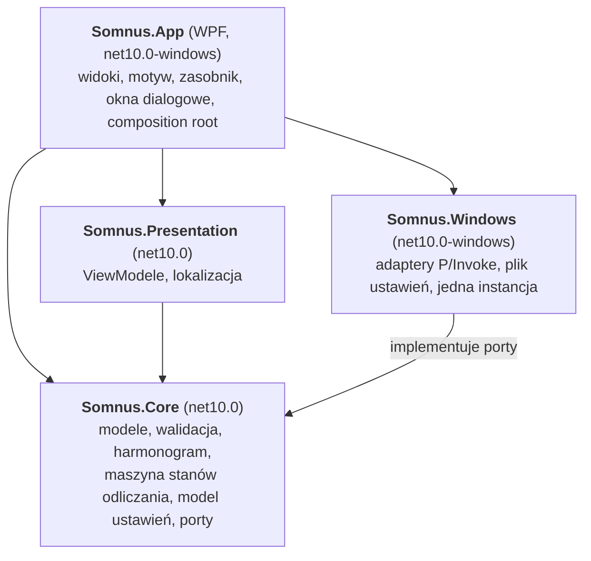
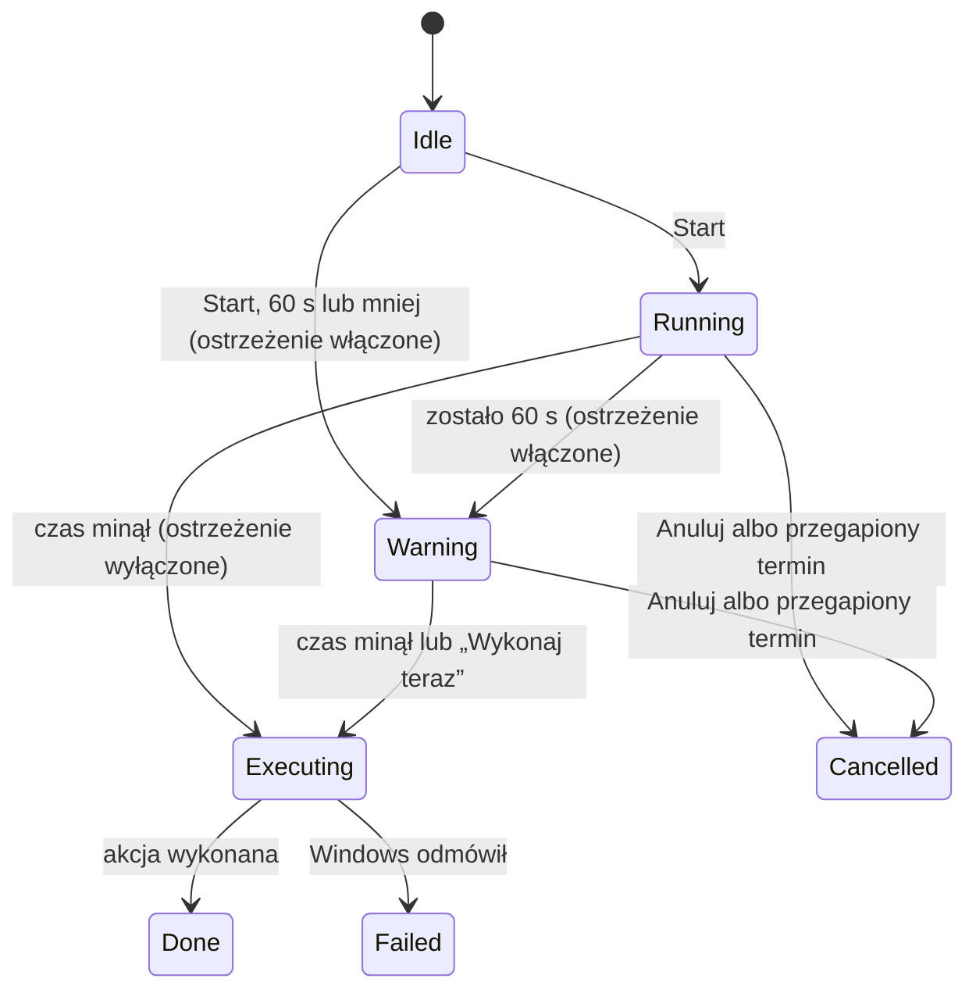
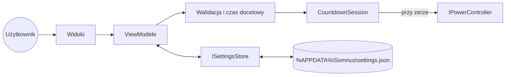

# Architektura

[English](ARCHITECTURE.md)

Somnus to mała aplikacja WPF podzielona na cztery projekty, żeby całą logikę dało się
testować bez Windowsa, bez interfejsu i bez dotykania prawdziwego stanu zasilania komputera.

## Moduły

Reguła zależności: `Core` nie zależy od żadnego innego projektu Somnusa; `Presentation`
i `Windows` zależą tylko od `Core`; `App` łączy całość. `Core` i `Presentation` nigdy nie
odwołują się do WPF, WinForms ani P/Invoke. Pilnują tego testy (`DependencyRuleTests`).

## Porty i adaptery

| Port (w Core) | Cel | Adapter (w Windows) | Atrapa w testach |
|---|---|---|---|
| `IPowerController` | Uśpienie, hibernacja, wyłączenie (opcjonalnie wymuszone) | `WindowsPowerController`: `SetSuspendState`, `ExitWindowsEx` (ADR 0006) | `DryRunPowerController`, atrapy |
| `IPowerCapabilities` | Które akcje obsługuje ten komputer | `WindowsPowerCapabilities`: `GetPwrCapabilities` | atrapy |
| `IKeepAwake` | Blokada automatycznego uśpienia w trakcie odliczania | `WindowsKeepAwake`: żądanie zasilania (ADR 0007) | atrapy |
| `ISettingsStore` | Odczyt i zapis ustawień | `JsonFileSettingsStore`: `%APPDATA%\Somnus\settings.json` | katalog tymczasowy |
| `IAutostart` | Uruchamianie z Windowsem, gdy użytkownik je włączy (#83) | `RunKeyAutostart`: klucz Run użytkownika | `SimulatedAutostart` w trybie próbnym, klucz testowy |
| `System.TimeProvider` | Bieżący czas i timery | `TimeProvider.System` | `FakeTimeProvider` |

Prawdziwe akcje zasilania są dostępne tylko przez `IPowerController`. `DryRunPolicy` decyduje
przy starcie: build Debug i uruchomienie z `--dry-run` dostają `DryRunPowerController`, który
loguje i zgłasza zdarzenie do powiadomienia zamiast działać (reguła R-01). Tylko composition
root może utworzyć `WindowsPowerController`, czego pilnuje kontrola w CI.

Możliwości: uśpienie wymaga S3 (komputery z Modern Standby nie mają S3 dostępnego dla aplikacji),
hibernacja wymaga S4 i pliku hibernacji, który usuwa `powercfg /hibernate off`.

Ustawienia trafiają najpierw do pliku tymczasowego, który potem zastępuje `settings.json`, więc
awaria zostawia stary albo nowy plik. Nieczytelny plik zostaje zachowany jako `settings.json.bak`,
zanim zostaną użyte wartości domyślne; pojedyncze błędne wartości wracają do domyślnych bez
utraty reszty.

## Odliczanie

Odliczaniem zarządza `CountdownSession` (Core):

- Cel to bezwzględna chwila w czasie. Pozostały czas to `cel - teraz`, liczony od nowa przy
  każdym takcie co 250 ms, więc odliczanie nie dryfuje (kryterium K2: ±2 s nawet po 24 h).
- Tryb *za*: cel = teraz + czas trwania. Tryb *o*: najbliższe lokalne wystąpienie HH:mm
  (dziś, jeśli jeszcze przed nami, w przeciwnym razie jutro), liczone według reguł strefy
  czasowej: godzina pominięta przy przestawieniu zegara do przodu przesuwa się o długość
  przerwy (02:30 staje się 03:30), a godzina występująca dwa razy przy cofnięciu zegara
  oznacza pierwsze wystąpienie, które jest jeszcze przed nami.
- Jeśli odliczanie trwa 60 s lub krócej, a ostrzeżenie jest włączone, zaczyna się od razu w stanie `Warning`.
- **Przegapiony termin:** przerwa dłuższa niż 5 s między dwoma taktami oznacza, że komputer
  spał albo zegar przeskoczył. Jeśli odliczanie wraca na mniej niż 60 s przed celem albo po nim,
  Somnus anuluje je zamiast działać, przy włączonym i wyłączonym ostrzeżeniu, więc wybudzenie
  komputera nigdy nie kończy się niespodziewaną akcją (założenie A8).
- Akcja zasilania działa w wątku w tle (uśpienie i hibernacja wracają dopiero po wybudzeniu);
  odrzucona lub nieudana akcja kończy się stanem `Failed` i wpisem w logu.
- Blokada uśpienia jest trzymana tylko w trakcie odliczania i zawsze zwalniana (R-06).
- Sesja jest bezpieczna wątkowo; zdarzenie `Changed` przychodzi przy zmianie stanu i raz na
  pełną sekundę, a odbiorcy czytają niezmienny `CountdownSnapshot`.

## Interfejs użytkownika

- **ViewModele** (`Somnus.Presentation`, CommunityToolkit.Mvvm): `MainViewModel` zamienia dane
  wejściowe w `CountdownRequest`, waliduje je na bieżąco, uruchamia, anuluje i restartuje odliczanie
  oraz zapamiętuje ostatnie wartości; `ShellViewModel` obsługuje ikonę w zasobniku, okno ostrzeżenia,
  powiadomienia i wyjście; `WarningViewModel` obsługuje okno ostrzeżenia, a `SettingsViewModel` panel
  ustawień, który `MainViewModel` otwiera w oknie głównym (język widać od razu). Zależą tylko
  od portów (`IUiDispatcher`, `IDialogService`, `INotificationService`), więc wszystkie mają testy jednostkowe.
- **Wątki:** odliczanie zgłasza `Changed` z wątków timera; ViewModele przechodzą na wątek UI przez
  `IUiDispatcher` i tam czytają niezmienny snapshot.
- **Widoki** (`Somnus.App/Views`): sam XAML, każdy kolor i czcionka z `Theme/*.xaml` (R-02), każdy
  tekst z `Strings.resx` przez rozszerzenie `{l:Tr Klucz}` (R-04). `ShellController` chowa okno główne
  do zasobnika po starcie odliczania, otwiera okno ostrzeżenia na ostatnią minutę i zamyka aplikację na
  żądanie; zamknięcie okna głównego w trakcie odliczania tylko je chowa (założenie A5).
- **Zasobnik:** `NotifyIcon` z WinForms (ADR 0006) z kolorami motywu w menu.
- **Kompozycja:** `CompositionRoot` buduje jeden `ServiceProvider` (sprawdzany przy budowie) i jest
  jedynym miejscem, które może utworzyć `WindowsPowerController` (R-01).
- **Języki:** `Strings.resx` (angielski) i `Strings.pl.resx` (polski); `Localizer` przełącza kulturę
  w trakcie działania i wszystkie powiązania podążają za nią (R-04).
- **Logi i błędy:** Serilog zapisuje `%APPDATA%\Somnus\logs\somnus-<data>.log`, jeden plik dziennie,
  7 wstecz. Nieobsłużone błędy w wątku UI są logowane i wyjaśniane w oknie; błędy w innych wątkach
  są logowane przed zakończeniem procesu; błędy niezaobserwowanych zadań też trafiają do logu.
- **Jedna instancja:** nazwany mutex w przestrzeni sesji (`Local\Somnus.Instance`); drugie
  uruchomienie ustawia nazwane zdarzenie, pierwsza instancja pokazuje okno, a druga się zamyka
  (R-09). Instalator sprawdza ten sam mutex.

## Przepływ danych

## Dane i logi

| Dane | Miejsce |
|---|---|
| Ustawienia | `%APPDATA%\Somnus\settings.json` |
| Logi | `%APPDATA%\Somnus\logs`, jeden plik dziennie, 7 dni wstecz |

Nic więcej nie jest zapisywane i nic nie jest wysyłane przez sieć (R-07).

## Build i self-test

`scripts/build.py` publikuje folder zależny od frameworka i tworzy pliki do pobrania (ADR 0009, ADR 0010). Manifest plików builda to `docs/build-manifest-win-x64.txt`.

`Somnus.exe --self-test [raport.json]` (`SelfTest`) przechodzi przez to, co gotowy build ładuje dopiero przy użyciu: oba języki, kołysankę, ustawienia, logi, composition root, funkcje zasilania i wszystkie okna. Startuje przed sprawdzeniem pojedynczej instancji, trzyma pliki w folderze tymczasowym, nie pokazuje okien, nie gra dźwięku i tylko symuluje akcje zasilania (R-01).
