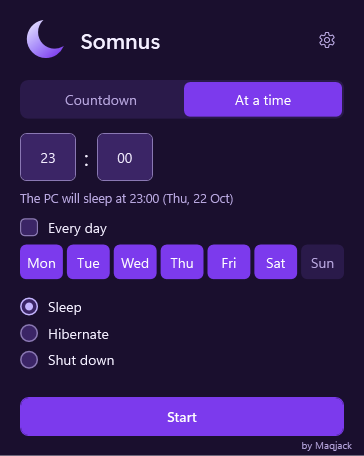
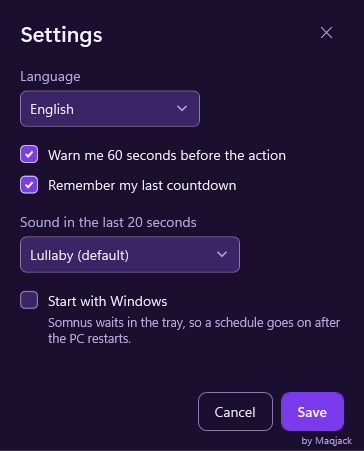
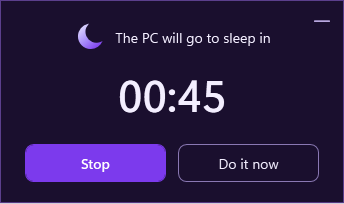

# How Somnus was made

[Polski](HOW-IT-WAS-MADE.pl.md) · [Back to the README](../README.md)

Somnus is a small Windows utility, and also an experiment: building a complete, polished desktop app
with AI coding agents under clear, written rules. This page shows how it was put together.

## The idea

Windows can shut down after a delay (`shutdown /s /t 3600`), but it cannot sleep or hibernate after
one, it makes you count seconds, and it never warns you. Somnus does all three, after a countdown or
at a clock time, with a 60-second warning you can stop, in a purple window that hides in the tray.

## Who did what

Mac ([@Maqjack](https://github.com/Maqjack)) came up with Somnus and made every product decision.
Mac was also responsible for:

- **the front-end design**: the look of every window, the colours and the texts;
- **keeping the project in order**: the scope, the rules and the order of the work;
- **the development pipeline**, which Mac built: the written standard (SWPA), the reviews and the
  quality gates that every change went through;
- **feedback and manual testing**: every release candidate was tried by hand on a real PC.

AI coding agents (Claude Code) wrote the code and the documents within that pipeline and ran part of
the testing: the automated tests and separate audits of the user experience, the look and the build.

## In numbers

| | |
|---|---|
| Development | from 22 October 2026, release 1.1.0 in November 2026 |
| Code | about 6,400 lines of C# and XAML in 4 projects, and about 6,100 lines of tests |
| Automated tests | about 540, on every change |
| Work items | 71 issues and about 45 pull requests |
| Size | the installer about 3 MB, about 7 MB after installation |
| Languages | English and Polish, everywhere: the app, the installers and the documents |

## Architecture

Four projects keep the logic testable without Windows, without a window and without ever touching the
real power state of the PC: `Core` (the countdown and its rules), `Presentation` (view models),
`Windows` (the power, registry and file adapters) and `App` (WPF windows that wire it all together).
A test enforces that dependency rule. More in [Architecture](ARCHITECTURE.md).

## Decisions worth a look

Each decision is a short record with its context and consequences:

- [WPF on .NET 10](adr/0001-tech-stack.md): the stack, and why not WinUI or Electron.
- [Direct Windows power APIs](adr/0006-windows-integration.md) and a
  [power request to keep the PC awake](adr/0007-keep-awake-power-request.md) instead of changing the
  user's power plan.
- [From 165 MB to 7 MB](adr/0010-framework-dependent-build.md): a build on the shared .NET runtime,
  which the installer downloads and verifies when it is missing.
- [A repeating schedule](adr/0011-repeating-schedule.md) that never acts on a surprise wake-up.
- [Following Windows' Text size](adr/0012-text-size.md) up to 225%.
- [English and Polish downloads](adr/0009-language-packages.md) and
  [no code signing yet](adr/0004-code-signing.md).

## How quality was kept

- **Every change** started as an issue with an acceptance criterion and went through a pull request
  and CI. A change Mac asked for merged only after an auditor confirmed that criterion.
- **CI** checks formatting, builds with warnings as errors, runs the tests with an 80% line coverage
  gate for the logic, and looks for known vulnerabilities, unapproved licences and secrets.
- **Project rules in code**: a test or a debug build can never sleep, hibernate or shut down the PC;
  colours come only from the theme; the app has no network code at all.
- **The installers** are tested on a clean CI runner: install, upgrade over an older version,
  download of the runtime with a checksum, wrong checksum, uninstall.
- **The built app** runs a self-test before every release, and every state of the interface is
  rendered off screen into pictures that the auditors review.
- **Accessibility**: full keyboard use, contrast checked by tests, Windows' Text size up to 225% and
  names for screen readers.

## Screenshots

  
  
  

