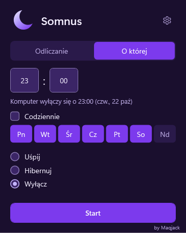
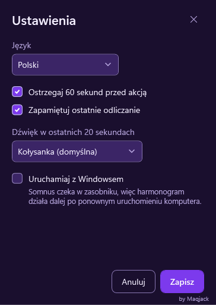
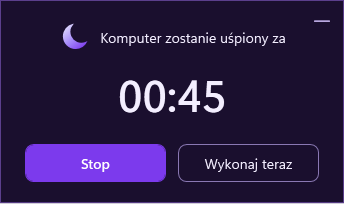

# Jak powstał Somnus

[English](HOW-IT-WAS-MADE.md) · [Wróć do README](../README.pl.md)

Somnus to mała aplikacja dla Windowsa, a zarazem eksperyment: zbudowanie kompletnej, dopracowanej
aplikacji przy pomocy agentów AI, według jasnych, spisanych zasad. Ta strona pokazuje, jak powstała.

## Pomysł

Windows potrafi wyłączyć się po czasie (`shutdown /s /t 3600`), ale nie uśpi się ani nie zahibernuje
po odliczeniu, każe liczyć sekundy i niczego nie ostrzega. Somnus robi wszystkie trzy rzeczy, po
odliczeniu albo o wskazanej godzinie, z 60-sekundowym ostrzeżeniem, które można zatrzymać, w
fioletowym oknie chowającym się do zasobnika.

## Kto co zrobił

Mac ([@Maqjack](https://github.com/Maqjack)) wymyślił Somnusa i podejmował wszystkie decyzje
produktowe. Odpowiadał też za:

- **projekt interfejsu**: wygląd każdego okna, kolory i teksty;
- **porządek w projekcie**: zakres, zasady i kolejność prac;
- **pipeline wytwarzania**, który sam zbudował: spisany standard (SWPA), przeglądy i bramki jakości,
  przez które przechodziła każda zmiana;
- **feedback i testy manualne**: każdą wersję kandydującą sprawdzał ręcznie na prawdziwym komputerze.

Kod i dokumenty pisali agenci AI (Claude Code) w ramach tego pipeline'u; prowadzili też część testów:
testy automatyczne i osobne audyty wygody użycia, wyglądu i builda.

## W liczbach

| | |
|---|---|
| Praca | od 22 października 2026, wydanie 1.1.0 w listopadzie 2026 |
| Kod | ok. 6400 linii C# i XAML w 4 projektach oraz ok. 6100 linii testów |
| Testy automatyczne | ok. 540, przy każdej zmianie |
| Zadania | 71 zgłoszeń i ok. 45 pull requestów |
| Rozmiar | instalator ok. 3 MB, ok. 7 MB po instalacji |
| Języki | polski i angielski wszędzie: w aplikacji, instalatorach i dokumentach |

## Architektura

Cztery projekty pozwalają testować logikę bez Windowsa, bez okien i bez dotykania prawdziwego zasilania
komputera: `Core` (odliczanie i jego reguły), `Presentation` (modele widoków), `Windows` (adaptery
zasilania, rejestru i plików) oraz `App` (okna WPF, które wszystko łączą). Tę zasadę zależności
pilnuje test. Więcej w opisie [architektury](ARCHITECTURE.pl.md).

## Decyzje warte uwagi

Każda decyzja to krótki zapis z kontekstem i skutkami (po angielsku):

- [WPF na .NET 10](adr/0001-tech-stack.md): wybór technologii i dlaczego nie WinUI ani Electron.
- [Bezpośrednie API zasilania Windowsa](adr/0006-windows-integration.md) i
  [żądanie zasilania, które nie pozwala zasnąć](adr/0007-keep-awake-power-request.md), zamiast
  zmiany planu zasilania użytkownika.
- [Ze 165 MB do 7 MB](adr/0010-framework-dependent-build.md): build na wspólnym środowisku .NET,
  które instalator pobiera i sprawdza, gdy go brakuje.
- [Harmonogram w dni tygodnia](adr/0011-repeating-schedule.md), który nigdy nie działa po
  niespodziewanym wybudzeniu.
- [Rozmiar tekstu z Windowsa](adr/0012-text-size.md) do 225%.
- [Polskie i angielskie wersje do pobrania](adr/0009-language-packages.md) oraz
  [na razie bez podpisu kodu](adr/0004-code-signing.md).

## Jak dbaliśmy o jakość

- **Każda zmiana** zaczynała się od zgłoszenia z kryterium akceptacji i przechodziła przez pull
  request i CI. Zmiana, o którą prosił Mac, wchodziła dopiero, gdy audytor potwierdził to kryterium.
- **CI** sprawdza formatowanie, buduje z ostrzeżeniami jako błędami, uruchamia testy z progiem 80%
  pokrycia logiki i szuka znanych podatności, niedozwolonych licencji oraz sekretów.
- **Reguły projektu w kodzie**: test ani build debug nigdy nie uśpi, nie zahibernuje ani nie wyłączy
  komputera; kolory pochodzą wyłącznie z motywu; aplikacja nie ma żadnego kodu sieciowego.
- **Instalatory** są testowane na czystej maszynie CI: instalacja, aktualizacja starszej wersji,
  pobranie środowiska z sumą kontrolną, błędna suma, odinstalowanie.
- **Zbudowana aplikacja** przed każdym wydaniem uruchamia autotest, a każdy stan interfejsu jest
  renderowany poza ekranem do obrazów, które oglądają audytorzy.
- **Dostępność**: pełna obsługa klawiaturą, kontrast sprawdzany testami, rozmiar tekstu z Windowsa do
  225% i nazwy dla czytników ekranu.

## Zrzuty ekranu

  
  
  

